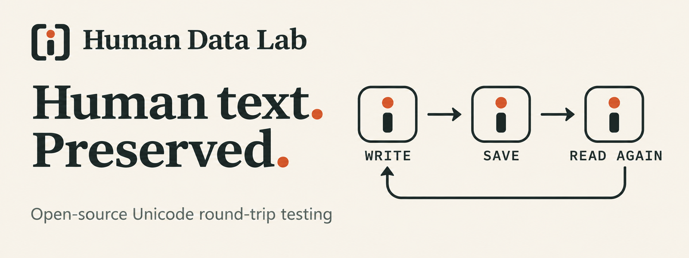
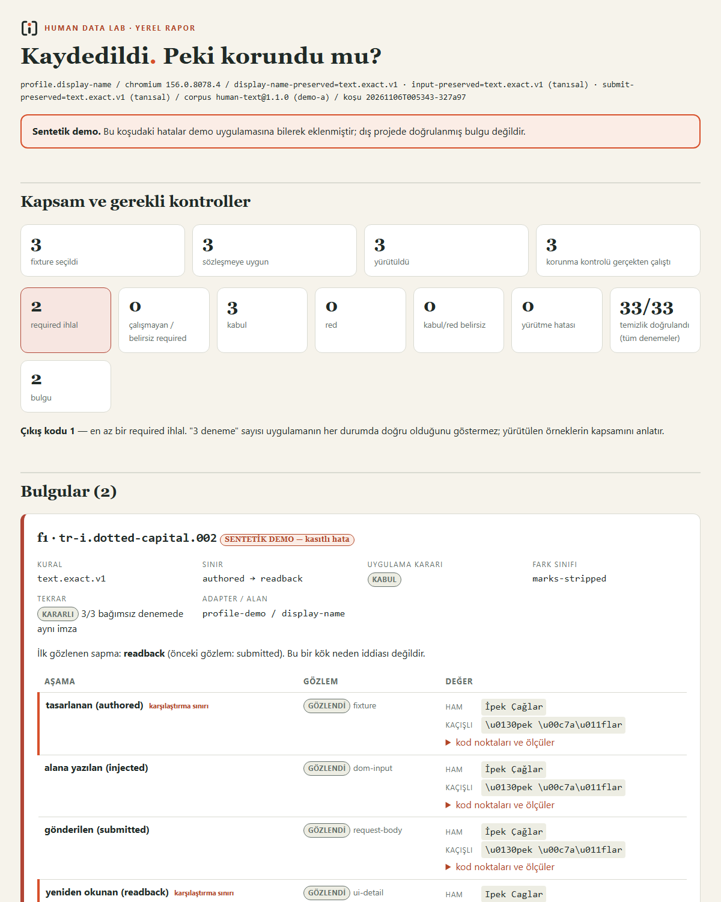
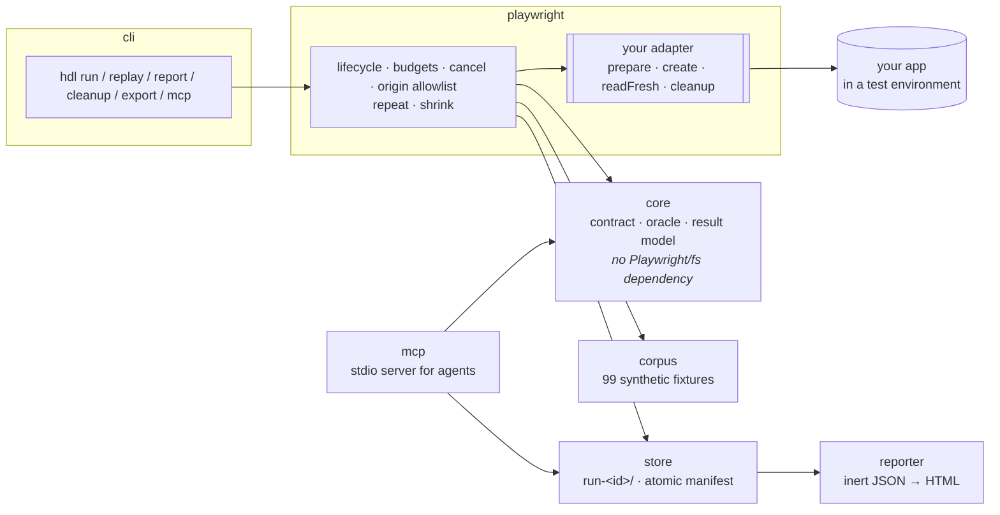
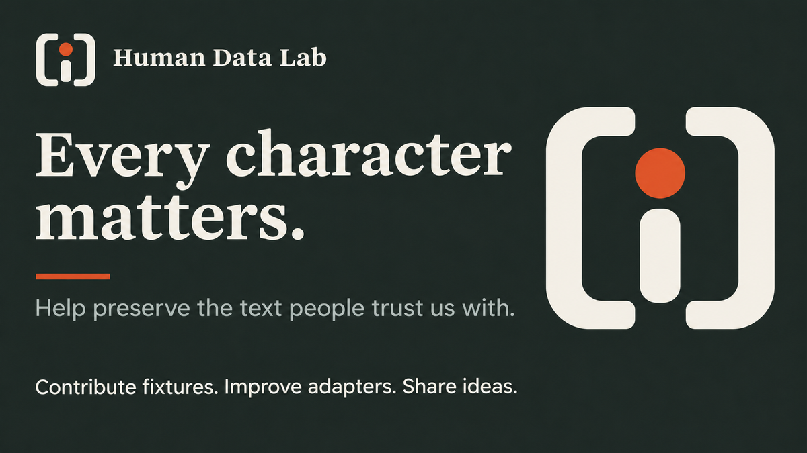

<div align="center">



<br>

[](https://github.com/ferattass/human-data-lab/actions/workflows/ci.yml)
[](https://github.com/ferattass/human-data-lab/actions/workflows/codeql.yml)
[](https://www.npmjs.com/package/human-data-lab)


**Türkçe:** [README.md](README.md) · **English:** this page

**A form saying "Saved" is not enough.**<br>
Human Data Lab checks whether the human text your application accepts (Turkish ı/İ, combining marks, emoji, right-to-left scripts)<br>
survives the **save → fresh re-read** journey in a real browser. Findings come with code-point-level evidence, reproduction context and a regression test.

[Why](#-why) · [30-second demo](#-30-second-demo) · [How it works](#-how-it-works) · [Your own app](#-in-your-own-application) · [Playwright tests](#-inside-an-existing-playwright-test) · [Agents & MCP](#-for-coding-agents-mcp) · [Status](#-status-and-roadmap) · [Contracts](docs/contracts.md)

</div>

---

## ✦ Why

Someone types `İpek Çağlar` into a name field, the server says "Saved", the screen shows `Ipek Caglar`. Unit tests pass, because every
layer is consistent with itself: the browser sends correctly, the API parses correctly, the database stores correctly, and one middleware
quietly "cleans". You only see the loss **end to end** and through an **independent re-read**. That is exactly what this tool does, and nothing else.

| Question | Usual answer | Human Data Lab |
|---|---|---|
| Was the data preserved? | Success toast or HTTP 200 | **Fresh read in a new context** by record id; `authored → readback` code-point equality |
| Which difference counts as a bug? | Whatever the test author decided that day | **A contract:** `must-accept / must-reject`, `text.exact.v1` or an explicitly chosen `text.nfc.v1` |
| Where did the loss start? | A guess | `authored / injected / submitted / readback` observed separately; the **first observed divergence** is marked |
| Can it be reproduced? | A screenshot | 3 independent repeats, **shrinking** under the same signature, `repro/f1.spec.ts`, **replay** with the stored value |
| Is the test environment clean? | Hope | Owned namespace and **verified cleanup**; otherwise exit 3 |

**Who it is for:** teams whose app accepts human text (profile names, customer display names, free-text notes) and who can write a Playwright test.
The framework does not matter: Laravel, Django, Rails, Next.js, an off-the-shelf CRM. A form in a browser and a way to find the record by id is enough.<br>
**When not to use it:** in production, on sites you are not authorized to test, in flows where you cannot re-find the record by id; for search, CSV/export and rich text (later phases).

---

## ▶ 30-second demo

```bash
npm ci
npx playwright install chromium
npm run demo
```

No account, no model key, no cloud. A local **synthetic** profile app runs in correct mode and with three deliberate bugs:


| Scenario | Lesson |
|---|---|
| **Correct mode** | The 24-fixture smoke corpus is preserved exactly; a technical-control input containing NUL is correctly rejected. |
| **A · Loss behind a success message** | The server strips combining marks. "Saved" is shown, the fresh read differs. The finding is stable 3/3 and shrinks `"İpek Çağlar"` to `"İ"`. The report does not invent a root cause; it shows the first observed divergence. |
| **B · Different code points, allowed equivalence** | The server applies NFC. An explicit `text.nfc.v1` policy passes while a diagnostic exact check keeps the raw difference visible. Not every difference is declared a bug. |
| **C · Rejection, violation and an execution block** | An expected rejection is not counted as preservation success; a dropped session is reported as an execution problem, not as "Unicode got corrupted". |

Every scenario produces an HTML report. Reports run no scripts, load no external resources and escape all data:



---

## ◇ How it works



1. **Describe the flow.** An adapter binds `prepare / create / readFresh / cleanup` to your application.
2. **You choose the expectation.** Which fixture families must be accepted, which rejected, and whether text must be preserved exactly or only up to NFC equivalence. The tool never guesses.
3. **Run against the real app.** Each fixture runs in its own namespace and a fresh browser context. The record is re-read independently by its id.
4. **Compare by rule.** `authored`, `injected`, `submitted` and `readback` observations are kept apart. Acceptance and preservation are two separate assertions.
5. **Reproduce.** A finding is confirmed in 3 independent trials, shrunk under a budget while keeping the same signature, and written out as `repro/f1.spec.ts`.



**There is no single green light.** Every trial is reported on five independent axes: `execution`, `applicationOutcome`, assertion status, `cleanup` and `reproducibility`. A required check that never ran is never shown as passed:

| Exit | Meaning |
|:-:|---|
| `0` | Required checks completed; no violation and nothing unresolved |
| `1` | At least one required violation |
| `2` | Configuration, execution, missing evidence or indeterminate result (**including required not-run**) |
| `3` | Cleanup could not be verified; owned data needs attention |
| `130` | Cancelled by the user; partial results and cleanup status are in the JSON |

---

## ⌂ In your own application

```bash
npx hdl init --adapter playwright        # scaffolds hdl/adapter.ts + hdl/roundtrip.config.ts (does not crawl your site)
# fill in the TODOs: field selector, record id, test namespace, cleanup path
npx hdl run hdl/roundtrip.config.ts --corpus smoke
```

**As a package (beta).** [Published on npm](https://www.npmjs.com/package/human-data-lab); each `vX.Y.Z` tag also attaches a tarball to the GitHub Release:

```bash
npm install human-data-lab @playwright/test     # or the Release tarball human-data-lab-X.Y.Z.tgz
```

Exports: `human-data-lab` (= `/playwright`), `human-data-lab/playwright/test`, `human-data-lab/core`, `human-data-lab/corpus`, `human-data-lab/store`, `human-data-lab/reporter`, `human-data-lab/mcp`, `human-data-lab/schema/*`.
The installed package runs the demo without sources on Linux, Windows and macOS (`test/package.test.ts`).

Prerequisites: a local or explicitly authorized staging environment, a test user, a way to find the record again by id, a separate namespace per trial and verifiable cleanup. Guide: [`docs/adapter-guide.md`](docs/adapter-guide.md). Working example: [`examples/profile-demo`](examples/profile-demo).

```bash
npx hdl replay runs/run-<id> --finding f1 --config hdl/roundtrip.config.ts   # stored concrete value, same target
npx hdl report runs/run-<id> [--json]                                        # integrity check + report (JSON for machines)
npx hdl cleanup runs/run-<id> --owned-only --config hdl/roundtrip.config.ts  # owned resources only
npx hdl export runs/run-<id> --out share/ [--dry-run]                        # allowlist; auth/trace excluded
```

---

## ✎ Inside an existing Playwright test

No separate CLI, no duplicated auth setup:

```ts
import { test, expect, expectTextPreserved } from 'human-data-lab/playwright/test';

test('profile name is preserved', async ({ humanData }) => {
  const r = await humanData.trial({ config, fixtureId: 'tr-i.dotted-capital.002', value: 'İpek Çağlar' });
  expect(r.violations, r.describe).toEqual([]);
});

// If you write your own save / reopen steps, use only the rule:
expectTextPreserved('İpek Çağlar', await page.getByTestId('display-name').textContent());
```

On failure the explanation is at code-point level:

```text
rule: text.exact.v1
difference class: marks-stripped  (first difference: code point 0)
expected: "İpek Çağlar"
actual:   "Ipek Caglar"
expected code points: U+0130 U+0070 U+0065 U+006B U+0020 U+00C7 U+0061 U+011F U+006C U+0061 U+0072
actual code points:   U+0049 U+0070 U+0065 U+006B U+0020 U+0043 U+0061 U+0067 U+006C U+0061 U+0072
```

Full example: [`examples/existing-test`](examples/existing-test). 5/5 green in correct mode, 3 red with explanations in broken mode.

---

## ⚙ For coding agents (MCP)

The tool ships a dependency-free [Model Context Protocol](https://modelcontextprotocol.io) server. Any MCP-capable assistant, IDE plugin or CI bot can use the oracle, the corpus and run evidence directly:

```bash
npx hdl mcp               # read-only tools + JSON Schema resources
npx hdl mcp --allow-run   # additionally enables hdl_run (writes to the target app; operator consent)
```

```json
{ "mcpServers": { "human-data-lab": { "command": "npx", "args": ["hdl", "mcp"] } } }
```

| Tool | Browser | Returns |
|---|:-:|---|
| `hdl_describe_difference` | no | rule result, difference class, first differing code point, escaped values, code points, measures |
| `hdl_list_fixtures` | no | corpus id/version/digest and fixtures, filtered by set, family or property |
| `hdl_validate_contract` | no | preflight validation of a flow contract |
| `hdl_read_run` | no | integrity problems, summary, findings, all attempts and stage observations of a run |
| `hdl_plan_export` | no | what a share bundle would include and exclude, with reasons |
| `hdl_run` | Chromium | a full run; only with `--allow-run`, serial, config file is imported |

Paths supplied by an agent must stay inside the server root (`--root`, default: the working directory); anything outside is rejected.

The same machine-readable view is available from the CLI with `hdl report <run> --json`. The agent contract (how to read exit codes, what never to claim) lives in [`AGENTS.md`](AGENTS.md). Decision record: [ADR 0010](docs/adr/0010-mcp-server.md). No model is called inside the core ([ADR 0005](docs/adr/0005-ai-optional.md)).

---

## ⧉ Corpus

99 synthetic fixtures, 11 families, `smoke` set of 24 ([`packages/corpus`](packages/corpus)):
Latin positive control · Turkish I family · precomposed/decomposed marks · NFKC compatibility · apostrophes and dashes · spaces, NBSP, invisible characters · length units · non-Latin and RTL scripts · emoji/ZWJ · line breaks (textarea) · technical controls (must-reject).

Fixtures describe the **text behaviour under test**, not a country stereotype. Every value is `\uXXXX`-escaped so invisible characters can be reviewed. No real personal data, no attack payloads. The acceptance policy belongs to the contract, not to the fixture.

---

## ✓ What we prove

```bash
npm run typecheck    # TypeScript 7, no build step
npm test             # 65 tests: 42 acceptance scenarios (A01–C14) + architecture + schema + Playwright integration + installed package + MCP
```

The 42 core acceptance scenarios of the product report are tracked by test name; `test/matrix.test.ts` fails if one disappears. Most tests run against **real Chromium** and the demo app with deliberate bug modes. They caught three real engine bugs during development:

- A missing readback observation was hidden by `Array.find`.
- An adapter call left behind after cancellation could create a record after cleanup.
- A non-ASCII directory name (`Yayında`) prevented the demo server from starting.

Scope and limits: [`docs/scope.md`](docs/scope.md) · measured timings: [`docs/performance.md`](docs/performance.md) · technical review answers: [`docs/review.md`](docs/review.md).

---

## ⚠ Limits

- **Chromium + Playwright `fill`.** Real keyboards, IME composition, paste and other browsers are not covered.
- **One field, one text round trip.** Search, CSV/export, dates, numbers and rich text are later phases.
- **Claims are bounded by the observed read path.** A UI read does not prove the API, an API read does not prove the render. "First observed divergence" is not a root cause.
- **No user pilot, no competitor benchmark yet.** Methods are in [`docs/pilot.md`](docs/pilot.md) and [`docs/benchmark.md`](docs/benchmark.md); no results were invented.
- The tool **writes to the target environment.** Run it only locally or in explicitly authorized environments: [`SECURITY.md`](SECURITY.md).

---

## ◷ Status and roadmap

| | |
|---|---|
| **Version** | v0.6.2 beta · source and compiled package · 65 tests · CI: Linux, Windows, macOS × Node 22, 24 |
| **Stable** | Single-field text round trip, contract and result model, evidence bundle, replay, shrinking, Playwright Test integration, MCP tools (runs only with `--allow-run`) |
| **Experimental** | `research/` tools (search, identity, collision) |
| **Next** | User pilot ([method](docs/pilot.md)) · date, number and rich-text fields · search and export journeys |
| **Breaking changes** | `0.X` releases may break and say so in the [CHANGELOG](CHANGELOG.md); schemas are versioned separately via `schemaVersion`, unknown major versions are refused |

---

## Documentation

| | |
|---|---|
| [`AGENTS.md`](AGENTS.md) | Contract for coding agents: commands, exit codes, RunView, MCP, what never to claim |
| [`docs/contracts.md`](docs/contracts.md) | Fixture, flow contract, observation boundaries, result model, evidence bundle, replay, shrinking |
| [`docs/adapter-guide.md`](docs/adapter-guide.md) | Writing an adapter for your own application |
| [`docs/cli.md`](docs/cli.md) | CLI reference: every command, flag and exit code (Turkish) |
| [`docs/scope.md`](docs/scope.md) | v0.1 scope contract and known limits |
| [`docs/release.md`](docs/release.md) | Versioning, tagging, GitHub Release and npm trusted publishing |
| [`docs/adr/`](docs/adr) | Decision records |
| [`docs/traceability.md`](docs/traceability.md) | Every section of the product report → code and tests |
| [`schema/`](schema) | Versioned JSON Schemas |
| [`research/`](research) | Early experiments (search, e-mail identity, name collision): **experimental**, outside v0.1 scope |
| [`docs/brand/`](docs/brand) | Visual identity: logo, mark, colours, usage rules |

Most documentation is written in Turkish; code comments, identifiers, schemas, CLI flags and the JSON outputs are stable and language-independent. English contributions and translations are welcome.

## Contributing

<a href="CONTRIBUTING.md"></a>

A new fixture, an adapter example or a bug report. Everything works on synthetic data; no customer data is ever needed.
[`CONTRIBUTING.md`](CONTRIBUTING.md) · [`SECURITY.md`](SECURITY.md) · [`CODE_OF_CONDUCT.md`](CODE_OF_CONDUCT.md) · [`CITATION.cff`](CITATION.cff)

## License

[Apache License 2.0](LICENSE). "Human Data Lab" is a working name; no trademark, domain or npm scope is claimed ([`NOTICE`](NOTICE)).

<div align="center">
<br>
<picture>
  <source media="(prefers-color-scheme: dark)" srcset="docs/brand/logo-horizontal-dark.webp">
  
</picture>
<br>
<sub><b>Every character matters.</b> · Animations respect <code>prefers-reduced-motion</code> · All demo data is synthetic</sub>
</div>
