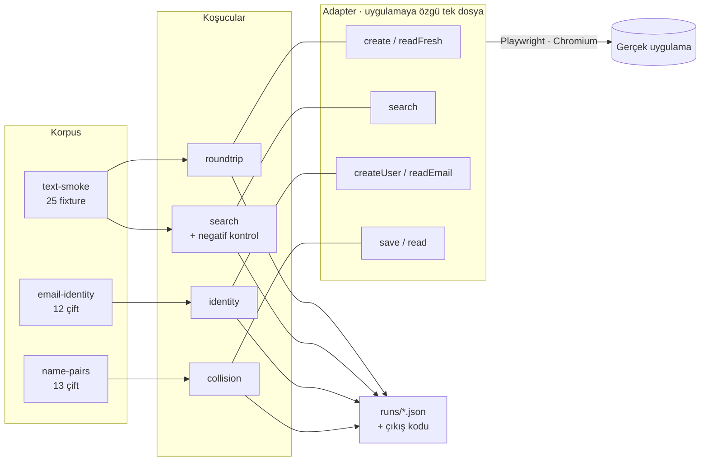

<div align="center">



<br>


**İnsan adlarını gerçek uygulamalara tarayıcıdan yazar, geri okur, arar, birbirine karıştırmaya çalışır.**<br>
Türkçe ı/İ, birleşik aksan, emoji, apostrof, aksanlı ikizler — testlerde olmayan ama kullanıcıda olan metin.

[Ne buldu](#-ne-buldu) · [Nasıl çalışır](#-nasıl-çalışır) · [Hızlı başlangıç](#-hızlı-başlangıç) · [Adapter yaz](#-kendi-uygulaman-için-adapter) · [Deneyleri tekrar üret](#-deneyleri-tekrar-üret) · [Sınırlar](#-sınırlar)

</div>

---

## ✦ Neden

Çoğu form testi `"John Smith"` ile yazılır. Gerçek kullanıcılar ise **Işık Yıldız**, **O'Brien**, **José** (bazen ayrık aksanla), **Ayşe 🙂** yazar.
Bu değerler çoğu zaman *kaydedilir* — "Başarılı" mesajı gelir — ama:

- geri okunduğunda **boş** ya da kırpılmış olabilir,
- kendi adıyla **aranınca bulunamaz**,
- yalnız aksanla ayrılan başka bir kayda (**Cam → Çam**) **yazılır**.

human-data-lab bu üç yolu (*roundtrip*, *arama*, *eşleme*) gerçek tarayıcıdan, gerçek uygulamalarda, tekrar üretilebilir ve **sapma noktası ayrıştırılmış** biçimde ölçer.

---

## ◆ Ne buldu

3 tur, 3 açık kaynak uygulama (WordPress, Gitea, Redmine · yerel Docker, sentetik veri). Ayrıntı ve ham kanıt: [`FINDINGS.md`](FINDINGS.md), `runs/*.json`.

| # | Uygulama | Ne oluyor | Tür | Kanıt |
|:-:|---|---|---|---|
| 1 | **Redmine 7.0.3** wiki (MySQL) | `Cam` sayfasını kaydetmek **`Çam` sayfasının üzerine yazar**. Şiş/Sis, Göl/Gol, Año/Ano, Straße/Strasse, Résumé/Resume de aynı. | sessiz üzerine yazma | `app/models/wiki.rb:58` `LOWER(title) = LOWER(?)` + `utf8mb4_0900_ai_ci` |
| 2 | **WordPress 7.1.4** Hızlı Düzenle | `Sis` etiketi yazılır, yazıya **`Şiş`** bağlanır. `C` yazılır → **`C++`**. Etiket yoksa 10/10 aksan/noktalama çifti karışır. | sessiz yanlış eşleme | `taxonomy_meta_box_sanitize_cb_input()` (collation) → `term_exists()` (slug) |
| 3 | **WordPress 7.1.4** yorum araması | `O'Brien` adlı yorumcu **tam adıyla bulunamaz** (`Brien` ile bulunur). | arama hatası | SQL: `LIKE '%O\\\'Brien%'` (wp_magic_quotes eğik çizgisi kalıyor) |
| 4 | Redmine · WordPress · Gitea | `Ilık Işık` Türkçe küçük/büyük harfle (`ılık ışık`, `ILIK IŞIK`) **bulunamaz**. | varsayılan collation | MySQL `0900_ai_ci` / Postgres; `tr_0900_ai_ci` ile düzeliyor |
| 5 | WordPress (eski `utf8mb3` tablo) | `Ayşe 🙂` → "New user created" der, **ad boş kaydedilir**. | sessiz veri kaybı | `meta_value = ''` (MySQL'de doğrulandı) |

**Sağlam çıkanlar (negatif sonuçlar da sonuçtur):** modern stack'te 25 fixture'lık roundtrip (4 alan, 3 uygulama, 0 ihlal) · e-posta kimliği (12 çift × 3 uygulama, aynı posta kutusuna ikinci hesap: 0) · Redmine CSV dışa aktarımı (UTF-8 + BOM).

<br>



<details>
<summary><b>Tek komutla tekrar üret</b> — <code>npm run repro:round3</code></summary>
<br>


Kontrol çifti **Kır/Kir** doğru geçer: MySQL `0900_ai_ci` ı ile i'yi ayırır. Bu, hatayı tahmin değil **collation davranışı** olarak bağlamayı mümkün kıldı.
</details>

---

## ◇ Nasıl çalışır



Her deney aynı ilkeyle kurulur: **kabul ile korunma ayrı ölçülür**, okuma **yeni bir tarayıcı oturumunda** yapılır, ilk sapma noktası raporlanır.
Gitea'daki uzun ad kesilmesi bu sayede sunucuya değil, tarayıcıdaki `maxlength=100`'e bağlandı (ilk sapma: `injected`).



| Koşucu | Soru | Kural | Hüküm |
|---|---|---|---|
| `roundtrip` | Kaydedilen metin aynen geri geliyor mu? | `text.exact.v1` (örtük trim / case-fold / NFKC **yok**); `text.nfc.v1` ayrıca | fark sınıfı: `emptied`, `truncated`, `marks-stripped`, `normalization-form-changed`, … |
| `search` | Kayıt, kullanıcının yazabileceği biçimlerle bulunuyor mu? | yalnız `exact` zorunlu; diğer 8 biçim gözlem | anlamsız sorgu "bulundu" derse koşu **durur** (exit 2) |
| `identity` | Aynı posta kutusunun farklı yazımı ikinci hesap açıyor mu? | `sameMailbox` çiftlerinde ikinci kabul = ihlal | sessiz değişiklik ayrıca işaretlenir |
| `collision` | Yalnız aksan/noktalamayla ayrılan adlar ayrı kayıt kalıyor mu? | `distinct` / `policy` / `control` beklentisi | `overwritten` · `merged` · `rejected` · `renamed` · `distinct` |



---

## ▶ Hızlı başlangıç

```bash
npm install
npx playwright install chromium

npm test              # 15 birim testi (saf modüller, tarayıcı yok)
npm run test:e2e      # 6 uçtan uca test: demo uygulaması doğru + hata modlarında
```

Docker gerektirmeyen demo:

```bash
npx hdl demo                        # doğru mod, :4310
PORT=4311 npx hdl demo latin1       # kasıtlı hata modu
PORT=4312 npx hdl demo fold-lookup  # Redmine/MySQL tarzı aksan duyarsız eşleme

BASE_URL=http://localhost:4311 npx hdl roundtrip adapters/demo.mjs
BASE_URL=http://localhost:4312 npx hdl collision adapters/demo-pages.mjs
```

<details>
<summary><b>Demo hata modları</b></summary>

| Mod | Taklit ettiği |
|---|---|
| `trim`, `collapse-space` | sanitize fonksiyonları (WordPress `sanitize_text_field` gibi) |
| `nfc`, `strip-marks` | normalleştirme / aksan atma |
| `latin1` | tek baytlık kodlamaya dönüşüm (`?` ile değiştirme) |
| `utf8mb3` | MySQL 3 baytlık UTF-8: ilk emojide metni keser |
| `truncate50` | sessiz uzunluk kesmesi |
| `fold-lookup` | benzersiz ad eşlemesi aksan + büyüklük duyarsız (MySQL `*_ai_ci`) |
| `slug-lookup` | benzersiz ad slug ile eşlenir (WordPress `term_exists`) |

Virgülle birleştirilebilir: `npx hdl demo trim,nfc`.
</details>

### Komutlar

```text
hdl roundtrip <adapter> [--corpus text-smoke] [--exclude emoji,…] [--out f.json]
hdl search    <adapter> [--only id,…] [--out f.json]
hdl identity  <adapter> [--only id,…] [--out f.json]
hdl collision <adapter> [--only id,…] [--out f.json]
hdl demo      [hata,modu,…]
```

**Çıkış kodları** — CI'da doğrudan kapı olarak kullanılabilir:

| Kod | Anlam |
|:-:|---|
| `0` | ihlal yok |
| `1` | ihlal bulundu (exact roundtrip, zorunlu arama, ikinci hesap, karışan ad) |
| `2` | sonuç **güvenilmez**: çalışmayan kontrol, sunucu hatası, negatif kontrol başarısız, kontrol çifti karıştı |

`2`'nin ayrı olması bilinçli: üç turda dört sahte sonuç yakalandı (adapter yarışı, değişmiş URL formatı, sayfa başlığındaki profil bağlantısı). Araç "yeşil" demeden önce kendini sınar.

---

## ✎ Kendi uygulaman için adapter

Uygulamaya özgü her şey tek dosyada; koşucular aynı kalır. Gerçek örnekler: [`adapters/`](adapters/) (WordPress, Gitea, Redmine, demo).

<details open>
<summary><b>roundtrip</b> — iki fonksiyon</summary>

```js
// adapters/benim-uygulamam.mjs
export default {
  name: 'benim-uygulamam-ad',
  async newContext(browser) { /* isteğe bağlı: oturum açılmış context */ return browser.newContext(); },
  async create(page, value) {
    await page.goto('http://localhost:3000/people/new');
    const field = page.getByLabel('Ad');
    await field.fill(value);
    const injected = await field.inputValue();          // tarayıcının gerçekte gönderdiği
    await page.getByRole('button', { name: 'Kaydet' }).click();
    const id = page.url().match(/\/people\/(\d+)/)?.[1];
    return id ? { injected, recordId: id } : { injected, rejected: 'doğrulama mesajı…' };
  },
  async readFresh(context, id) {                         // YENİ context: önbellek/form durumu taşınmaz
    const page = await context.newPage();
    await page.goto(`http://localhost:3000/people/${id}/edit`);
    return page.getByLabel('Ad').inputValue();
  },
};
```
</details>

<details>
<summary><b>search</b> — <code>search(context, query, recordId) → { found }</code></summary>

Sonuç sayfasında **o kaydın** bağlantısını ara, genel bir metni değil. Koşucu ilk fixture'dan önce anlamsız bir sorgu gönderir; `found: true` dönerse adapter güvenilmez sayılır ve matris üretilmez.
</details>

<details>
<summary><b>identity</b> — <code>createUser(page, { login, email })</code> · <code>readEmail(context, id)</code></summary>

`type="email"` alanı değeri tarayıcıda kendisi düzeltebilir (boşluk, IDN). Sunucu davranışını ölçmek için alanı `text` yapın — gerçek adapter'lar bunu yapar.
</details>

<details>
<summary><b>collision</b> — <code>save(page, { name, body }) → { recordId }</code> · <code>read(context, id) → { name, body? }</code></summary>

`recordId` uygulamanın **gerçekte yazdığı** kaydın kimliği olmalı (yönlendirilen URL, bağlanan etiketin id'si) — girilen ad değil.
Gövdesi olmayan kayıtlar (etiket, kategori) için `bodyless: true` verin.
</details>

### Mevcut Playwright testinde

```js
import { test } from '@playwright/test';
import { loadCorpus, expectTextPreserved } from 'human-data-lab/src/index.mjs';

for (const f of loadCorpus('text-smoke', { exclude: ['emoji'] })) {
  test(`ad korunur: ${f.id}`, async ({ page }) => {
    /* doldur, kaydet, yeniden aç */
    expectTextPreserved(f.value, readback, { label: f.id });
  });
}
```

Başarısızlıkta mesaj kod noktası düzeyindedir:

```text
Metin korunmadı [tr.dotted-capital-i.001]
kural: text.exact.v1 → failed
fark sınıfı: marks-stripped  (ilk fark: 0 . kod noktası)
beklenen: "İpek Çağlar"
okunan:   "Ipek Caglar"
beklenen kod noktaları: U+0130 U+0070 U+0065 U+006B U+0020 U+00C7 U+0061 U+011F U+006C U+0061 U+0072
okunan kod noktaları:   U+0049 U+0070 U+0065 U+006B U+0020 U+0043 U+0061 U+0067 U+006C U+0061 U+0072
```

---

## ⧉ Korpus

| Dosya | İçerik |
|---|---|
| [`corpus/text-smoke.json`](corpus/text-smoke.json) | 25 fixture: Türkçe ı/İ ve tam alfabe, NFC/NFD/yığılmış aksan, ASCII ve tipografik apostrof, kısa çizgi, baş/son/çift boşluk, NBSP, Arapça, İbranice, Farsça ZWNJ, CJK (BMP ve astral), Devanagari, Yunanca son sigma, ß, emoji (temel, ZWJ dizisi, ten tonu), uzun ad |
| [`corpus/email-identity.json`](corpus/email-identity.json) | 12 çift: büyüklük, boşluk, IDN ↔ punycode, NFD, tam genişlik, ı/İ, Kelvin `K`, uzun `ſ` |
| [`corpus/name-pairs.json`](corpus/name-pairs.json) | 13 çift: çam/cam, şiş/sis, kül/kul, göl/gol, kır/kir, año/ano, Straße/Strasse, résumé/resume, C++/C, C#/C, Ankara/ANKARA, tam genişlik + **kontrol** Elma/Armut |

Korpus sentetik; gerçek kişi verisi içermez. Her fixture'ın `properties` etiketi var; `--exclude` ile alt küme seçilir.

---

## ↻ Deneyleri tekrar üret

```bash
cd experiments/wordpress && docker-compose up -d    # :8081
cd experiments/gitea     && docker-compose up -d    # :8082
cd experiments/redmine   && docker-compose up -d    # :8083
```

Adapter'lar şu yönetici hesaplarını bekler: WordPress `admin / admin12345`, Gitea `hdladmin / admin12345`, Redmine `admin / admin12345`. Örnek kurulum:

```bash
# WordPress
docker-compose run --rm cli wp core install --url=http://localhost:8081 --title=hdl \
  --admin_user=admin --admin_password=admin12345 --admin_email=admin@example.com --skip-email
# Gitea
docker exec -u git gitea-gitea-1 gitea admin user create --admin \
  --username hdladmin --password admin12345 --email hdladmin@example.com --must-change-password=false
# Redmine (varsayılan admin/admin; ilk girişte değiştirin ya da)
docker exec -e SECRET_KEY_BASE=hdltestsecretkeybasehdltestsecretkeybase redmine-redmine-1 bin/rails runner \
  "u=User.find_by_login('admin'); u.password=u.password_confirmation='admin12345'; u.must_change_passwd=false; u.save!"
```

```bash
npx hdl collision adapters/redmine-wiki.mjs        # Bulgu 1
npx hdl collision adapters/wp-tag-quickedit.mjs    # Bulgu 2
npx hdl search    adapters/wp-comment.mjs          # Bulgu 3–4
npm run repro:round3                               # 1 + 2, tek komut, kontrol çiftli
```

Görseller veriden üretilir: `npm run assets` (`runs/search-*.json` → `docs/assets/matrix.svg`).

---

## ⚠ Sınırlar

Dürüst olmak gerekirse:

- **Giriş yöntemi:** Chromium + Playwright `fill`. IME, gerçek klavye, yapıştırma, mobil klavye ve otomatik düzeltme test edilmedi.
- **Ölçek:** uygulama başına bir veya birkaç alan; tam uygulama taraması değil.
- **Ortam:** Docker'daki varsayılan kurulumlar. Postgres'li Redmine, farklı MySQL collation'ları, eklentili WordPress denenmedi.
- **Kayıt durumu:** Bulgu 2–3'ün WordPress Trac'te bilinen bir kaydı olup olmadığı elle kontrol edilmeli (Trac otomatik erişimi engelliyor).
- **Hüküm kapsamı:** sonuç yalnız seçilen kural ve okuma yolu için geçerlidir; "sağlam" = bu korpus ve bu yol için ihlal görülmedi.

---

## ⌂ Proje yapısı

```text
bin/hdl.mjs              tek CLI
src/
  compare.mjs            saf karşılaştırıcılar, fark sınıflandırma, kod noktası açıklaması
  index.mjs              roundtrip + expectTextPreserved + loadCorpus
  run.mjs                roundtrip koşucusu
  variants.mjs           arama sorgusu biçimleri (tr/root küçük-büyük, NFD, ASCII…)
  search-run.mjs         arama koşucusu (negatif kontrollü)
  identity.mjs           posta kutusu anahtarı, kimlik işaretleri
  identity-run.mjs       e-posta kimlik koşucusu
  collision.mjs          çakışma sınıflandırıcı + hüküm
  collision-run.mjs      çakışma koşucusu
  csv.mjs                beyan edilen charset'le CSV çözme (RFC 4180)
adapters/                demo, WordPress, Gitea, Redmine
corpus/                  text-smoke, email-identity, name-pairs
demo-app/server.mjs      hata modlu sentetik uygulama
experiments/             docker-compose dosyaları + repro-round3.mjs
runs/                    ham koşu sonuçları (JSON)
test/                    birim + uçtan uca testler
docs/assets/             README animasyonları (SVG, script yok)
scripts/build-assets.mjs veri taşıyan görselleri runs/ içinden üretir
```

---

## ➜ Yol haritası

- [ ] Ad çifti korpusunu büyütmek (Lehçe, Vietnamca, Çekçe aksan ikizleri; Japonca kana genişliği)
- [ ] Postgres'li Redmine ve `utf8mb4_tr_0900_ai_ci` ile karşılaştırmalı koşu
- [ ] Giriş yöntemi katmanı: `keyboard.type`, pano yapıştırma, IME simülasyonu
- [ ] Dışa aktarım yolları: CSV/XLSX/PDF için ortak `exportValue` sözleşmesi
- [ ] Bulguların sorumlu bildirimi (WordPress Trac, Redmine.org) — bildirimden önce mevcut kayıtlar kontrol edilecek

---

<div align="center">
<sub>MIT · Sentetik veri · Animasyonlar <code>prefers-reduced-motion</code> ayarına uyar</sub>
</div>
