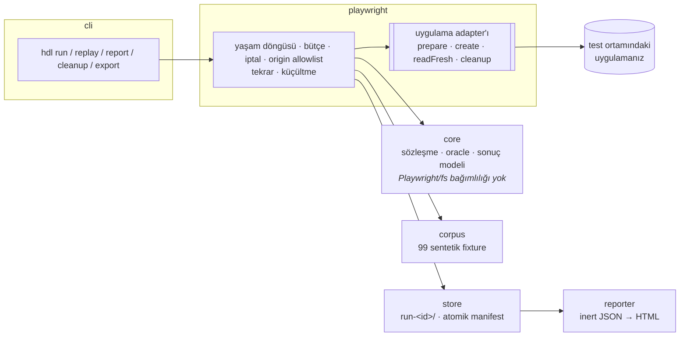

<div align="center">


<br>

[](https://github.com/ferattass/human-data-lab/actions/workflows/ci.yml)


**Bir formun "Kaydedildi" demesi yeterli değil.**<br>
Uygulamanızın kabul ettiği insan metninin (Türkçe ı/İ, birleşik aksan, emoji, sağdan sola yazı) kaydet → taze okuma yolculuğunda<br>
korunup korunmadığını gerçek tarayıcıda sınar. Bulguyu kod noktası düzeyinde kanıtla, tekrar üretim bilgisiyle ve regresyon testi olarak teslim eder.

<sub>*Open-source testing tool that checks whether human text your app accepts survives the save → fresh re-read journey, using a real browser via Playwright.*</sub>

[30 saniyelik demo](#-30-saniyelik-demo) · [Nasıl çalışır](#-nasıl-çalışır) · [Kendi uygulamanızda](#-kendi-uygulamanızda) · [Playwright testinde](#-mevcut-playwright-testinde) · [Sözleşmeler](docs/contracts.md) · [Kapsam](docs/scope.md)

</div>

---

## ▶ 30 saniyelik demo

```bash
npm ci
npx playwright install chromium
npm run demo
```

Hesap, model anahtarı veya bulut gerekmez. Yerel bir **sentetik** profil uygulaması, doğru modda ve üç bilinçli hatayla çalışır (rapor §35):


| Senaryo | Ders |
|---|---|
| **Doğru mod** | 24 fixture'lık smoke corpus aynen korunur; NUL içeren teknik kontrol girdisi doğru reddedilir. |
| **A · Başarı mesajının arkasındaki kayıp** | Sunucu birleşik işaretleri atar. "Kaydedildi" görünür, taze okuma farklıdır. Bulgu 3/3 kararlı, `"İpek Çağlar"` → `"İ"` diye küçültülür. Rapor kök neden uydurmaz; ilk gözlenen sapmayı gösterir. |
| **B · Farklı kod noktası, izinli eşdeğerlik** | Sunucu NFC uygular. Açık `text.nfc.v1` politikası geçer, tanısal exact kontrolü ham farkı görünür tutar. Araç her farkı hata ilan etmez. |
| **C · Red, ihlal ve yürütme engeli** | Beklenen red korunma başarısı sayılmaz; oturum düşmesi "Unicode bozuldu" diye raporlanmaz. |

Her senaryo bir HTML raporu üretir. Raporlar script çalıştırmaz, dış kaynak yüklemez, veriyi escape'ler:


---

## ◇ Nasıl çalışır


1. **Akışı tanımla.** Adapter `prepare / create / readFresh / cleanup` adımlarını sizin uygulamanıza bağlar.
2. **Beklentiyi siz seçin.** Hangi fixture ailesi kabul edilmeli, hangisi reddedilmeli, metin exact mı korunmalı yoksa NFC eşdeğerliği yeterli mi? Araç tahmin etmez.
3. **Gerçek uygulamada dene.** Her fixture ayrı namespace'te, yeni browser context'inde çalışır. Kayıt kimliğiyle bağımsız taze okuma yapılır.
4. **Kurala göre karşılaştır.** `authored`, `injected`, `submitted` ve `readback` gözlemleri ayrı tutulur. Kabul ile korunma iki ayrı assertion'dır.
5. **Hatayı yeniden üret.** Bulgu 3 bağımsız denemede doğrulanır, aynı imzayı koruyan bütçeli küçültme yapılır, `repro/f1.spec.ts` yazılır.



**Tek yeşil yok.** Her deneme beş bağımsız boyutta raporlanır: `execution`, `applicationOutcome`, assertion durumu, `cleanup` ve `reproducibility`. Çalışmayan bir required kontrol asla "geçti" görünmez:

| Exit | Anlam |
|:-:|---|
| `0` | Gerekli kontroller tamamlandı; ihlal veya çözümsüz durum yok |
| `1` | En az bir required ihlal |
| `2` | Yapılandırma, yürütme, eksik kanıt veya belirsiz sonuç (**required not-run dahil**) |
| `3` | Cleanup doğrulanamadı; sahipli veri için işlem gerekiyor |
| `130` | Kullanıcı iptali; kısmi sonuç ve cleanup durumu JSON'da |

---

## ⌂ Kendi uygulamanızda

```bash
npx hdl init --adapter playwright        # hdl/adapter.ts + hdl/roundtrip.config.ts taslakları (siteyi keşfetmez)
# TODO'ları doldurun: alan seçicisi, kayıt kimliği, test namespace'i, temizlik yolu
npx hdl run hdl/roundtrip.config.ts --corpus smoke
```

**Paket olarak (beta).** npm kayıt defterinde henüz yok. Kendi projenize kurmak için depoda `npm pack` çalıştırın
(derlenmiş `dist/` üretir), sonra projenizde `npm install /yol/human-data-lab-0.5.0.tgz @playwright/test`.
Dışa aktarımlar: `human-data-lab`, `human-data-lab/playwright/test`, `human-data-lab/core`, `human-data-lab/corpus`.
Bu yol `test/package.test.ts` ile Linux, Windows ve macOS'ta sınanıyor.

Önkoşullar: yerel veya izinli staging ortamı, test kullanıcısı, kaydı kimliğiyle yeniden bulma yolu, deneme başına ayrı namespace ve doğrulanabilir temizlik. Rehber: [`docs/adapter-guide.md`](docs/adapter-guide.md). Çalışan örnek: [`examples/profile-demo`](examples/profile-demo).

```bash
npx hdl replay runs/run-<id> --finding f1 --config hdl/roundtrip.config.ts   # saklı somut değerle, aynı hedefte
npx hdl report runs/run-<id>                                                 # bütünlük denetimi + rapor
npx hdl cleanup runs/run-<id> --owned-only --config hdl/roundtrip.config.ts  # yalnız sahipli kaynaklar
npx hdl export runs/run-<id> --out share/                                    # allowlist; auth/trace hariç
```

---

## ✎ Mevcut Playwright testinde

Ayrı bir CLI veya auth düzeni kopyalamadan:

```ts
import { test, expect, expectTextPreserved } from 'human-data-lab/playwright/test';

test('profil adı korunur', async ({ humanData }) => {
  const r = await humanData.trial({ config, fixtureId: 'tr-i.dotted-capital.002', value: 'İpek Çağlar' });
  expect(r.violations, r.describe).toEqual([]);
});

// Kendi kaydet/yeniden-aç adımlarınızı yazıyorsanız yalnız kural:
expectTextPreserved('İpek Çağlar', await page.getByTestId('display-name').textContent());
```

Başarısızlıkta açıklama kod noktası düzeyindedir:

```text
kural: text.exact.v1
fark sınıfı: marks-stripped  (ilk fark: 0. kod noktası)
beklenen: "İpek Çağlar"
görülen:  "Ipek Caglar"
beklenen kod noktaları: U+0130 U+0070 U+0065 U+006B U+0020 U+00C7 U+0061 U+011F U+006C U+0061 U+0072
görülen kod noktaları:  U+0049 U+0070 U+0065 U+006B U+0020 U+0043 U+0061 U+0067 U+006C U+0061 U+0072
```

Tam örnek: [`examples/existing-test`](examples/existing-test). Doğru modda 5/5 yeşil, bozuk modda 3 kırmızı ve açıklamalı.

---

## ⧉ Corpus

99 sentetik fixture, 11 aile, `smoke` seti 24 fixture ([`packages/corpus`](packages/corpus)):
Latin pozitif kontrol · Türkçe I ailesi · önceden birleşmiş/ayrık aksan · NFKC uyumluluk · apostrof ve tire · boşluk, NBSP, görünmez karakter · uzunluk birimleri · Latin dışı ve RTL yazı · emoji/ZWJ · satır sonu (textarea) · teknik kontrol (must-reject).

Ülke stereotipi değil, **sınanan metin davranışı** yazılır. Görünmez karakterler incelenebilsin diye her değer `\uXXXX` kaçışlıdır. Gerçek kişi verisi ve saldırı payload'ı yoktur. Kabul politikasını fixture değil sözleşme belirler.

---

## ✓ Neyi kanıtlıyoruz

```bash
npm run typecheck    # TypeScript 7, build adımı yok
npm test             # 59 test: 42 kabul senaryosu (A01–C14) + mimari + şema + Playwright entegrasyonu + kurulu paket
```

Raporun 42 çekirdek kabul senaryosu test adlarıyla izlenir; `test/matrix.test.ts` bir senaryonun testi kaybolursa kırılır. Testlerin çoğu **gerçek Chromium** ve kasıtlı hata modlu demo uygulamasıyla koşar. Bu testler geliştirme sırasında üç gerçek motor hatasını yakaladı:

- Eksik readback gözlemi `Array.find` yüzünden gizleniyordu.
- İptalden sonra yarım kalan bir adapter çağrısı, cleanup'tan sonra yeni kayıt yaratabiliyordu.
- ASCII dışı bir dizin adı (`Yayında`) demo sunucusunun başlamasını engelliyordu.

Kapsam ve sınırlar: [`docs/scope.md`](docs/scope.md) · ölçülmüş süreler: [`docs/performance.md`](docs/performance.md) · teknik review cevapları: [`docs/review.md`](docs/review.md).

---

## ⚠ Sınırlar

- **Chromium + Playwright `fill`.** Gerçek klavye, IME composition, yapıştırma ve diğer tarayıcılar doğrulanmış sayılmaz.
- **Tek alan, tek metin roundtrip'i.** Arama, CSV/export, tarih, sayı ve zengin metin sonraki fazdır.
- **İddia yalnız gözlenen okuma yoluyla sınırlıdır.** UI okuması API'yi, API okuması render'ı kanıtlamaz. "İlk gözlenen sapma" kök neden değildir.
- **Kullanıcı pilotu ve rakip benchmark'ı yapılmadı.** Yöntemleri [`docs/pilot.md`](docs/pilot.md) ve [`docs/benchmark.md`](docs/benchmark.md) içinde, sonuç uydurulmadı.
- Araç test ortamında **yazma işlemi yapar.** Yalnız yerel veya açıkça izinli ortamlarda çalıştırın: [`SECURITY.md`](SECURITY.md).

---

## Belgeler

| | |
|---|---|
| [`docs/contracts.md`](docs/contracts.md) | Fixture, akış sözleşmesi, gözlem sınırları, sonuç modeli, kanıt paketi, replay, küçültme |
| [`docs/adapter-guide.md`](docs/adapter-guide.md) | Kendi uygulamanız için adapter yazmak |
| [`docs/scope.md`](docs/scope.md) | v0.1 kapsam sözleşmesi ve bilinen sınırlar |
| [`docs/adr/`](docs/adr) | Karar kayıtları |
| [`docs/traceability.md`](docs/traceability.md) | Ürün raporunun her bölümü → kod ve test |
| [`schema/`](schema) | Sürümlü JSON Schema'lar |
| [`research/`](research) | Erken deneyler (arama, e-posta kimliği, ad çakışması): **deneysel**, v0.1 kapsamı dışında |
| [`docs/brand/`](docs/brand) | Görsel kimlik: logo, sembol, renkler, kullanım kuralları |

## Katkı

<a href="CONTRIBUTING.md"></a>

Yeni bir fixture, bir adapter örneği veya bir hata bildirimi. Hepsi sentetik verinin üzerinde çalışır, gerçek müşteri verisi gerekmez.
[`CONTRIBUTING.md`](CONTRIBUTING.md) · [`SECURITY.md`](SECURITY.md) · [`CODE_OF_CONDUCT.md`](CODE_OF_CONDUCT.md)

## Lisans

[Apache License 2.0](LICENSE). "Human Data Lab" bir çalışma adıdır; marka, alan adı veya npm adı tahsis edilmemiştir ([`NOTICE`](NOTICE)).

<div align="center">
<br>
<picture>
  <source media="(prefers-color-scheme: dark)" srcset="docs/brand/logo-horizontal-dark.webp">
  
</picture>
<br>
<sub><b>Every character matters.</b> · Animasyonlar <code>prefers-reduced-motion</code> ayarına uyar · Tüm demo verisi sentetiktir</sub>
</div>
