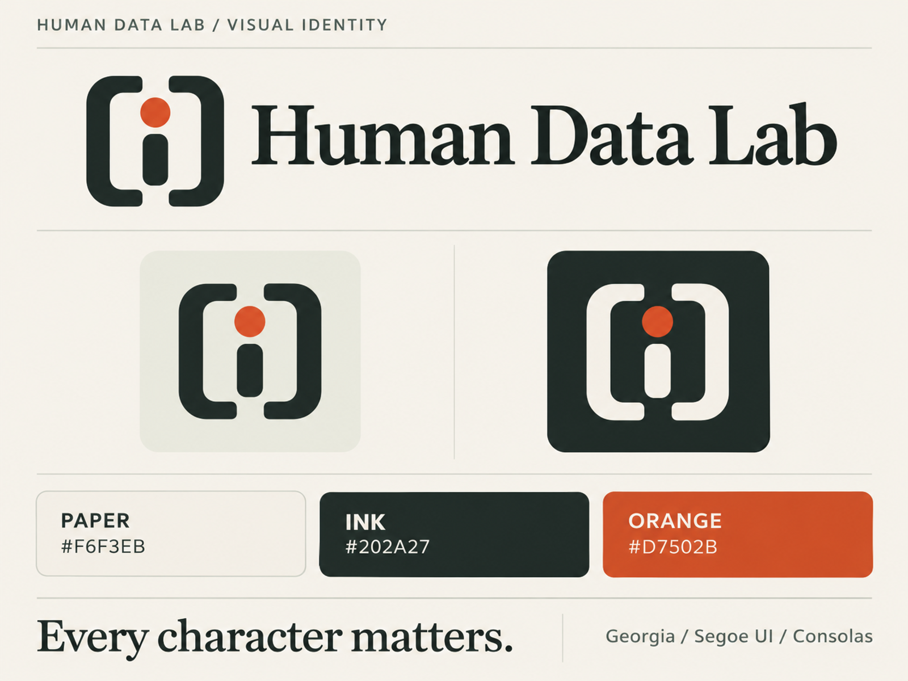

# Görsel kimlik

**Every character matters.** Sembol, köşeli parantez içinde bir "i": korunan karakter, turuncu nokta ise dikkat edilen ayrıntı.

## Renkler

| Ad | Hex | Kullanım |
|---|---|---|
| Paper (sıcak kırık beyaz) | `#F6F3EB` | Ana zemin |
| Ink (koyu mürekkep) | `#202A27` | Metin, sembol, koyu zemin |
| Orange (turuncu vurgu) | `#D7502B` | Sembolün noktası, vurgu çizgisi, başlık noktası |
| Koyu turuncu | `#B24526` | Açık zeminde **küçük metin ve bağlantılar** (`#D7502B` küçük metinde WCAG AA kontrastının altında kalır) |
| Gri yeşil | `#65706B` | İkincil metin |
| Ayırıcı | `#D9DAD1` | Çizgi ve kenarlık |
| Açık adaçayı | `#EDEDE3` | Yüzey, kod arka planı |
| Sakin yeşil | `#47705C` | Geçen kontrol |
| İhlal | `#B14535` | Başarısız required kontrol |
| Beyaz | `#FFFFFF` | Kart yüzeyi |

HTML rapor (`packages/reporter`) ve README animasyonları (`docs/assets/*.svg`) bu paleti kullanır.
Durumlar hiçbir zaman yalnız renkle anlatılmaz; her rengin yanında metin etiketi bulunur.

## Yazı karakterleri

Başlık: Georgia · Gövde ve arayüz: Segoe UI · Teknik değerler: Consolas. Font dosyaları dağıtılmaz; sistem fontları kullanılır.

## Dosyalar

| Dosya | Kullanım |
|---|---|
| `readme-hero-tr-1600x600.webp` | README üst görseli (Türkçe) |
| `readme-hero-light-1600x600.webp` | `README.en.md` üst görseli (İngilizce) |
| `logo-horizontal-ink.webp` | Açık zeminde yatay logo |
| `logo-horizontal-dark.webp` | Koyu tema için mürekkep zeminli yatay logo (opak; şeffaf değil) |
| `mark-color-master-256.png`, `mark-color-master-64.png` | Sembol |
| `favicon.ico` | 16/32/48 px |
| `github-social-dark-1280x640.png` | GitHub **Settings → General → Social preview** görseli |
| `contributor-card-1200x675.webp` | Katkı çağrısı |
| `brand-board-1600x1200.webp` | Kimlik sisteminin sunumu |

Tam paket (tüm boyutlar, avatarlar, sosyal kartlar, üretim kaynakları) depoya eklenmedi; yalnız kullanılan dosyalar burada.

## Kurallar

- Logoyu esnetmeyin veya kırpmayın. Koyu mürekkep işaretleri açık zeminde kullanın.
- Sembolün çevresinde en az noktanın çapı kadar boşluk bırakın.
- Yuvarlak kırpılan arayüzlerde (avatar) kenardaki işaretin kesilmediğini kontrol edin.
- Sürüm ve sosyal kartları gerçek sürüm, tarih ve proje durumuyla birlikte kullanın.

`recolor.mjs`: README animasyonlarını bu palete çeviren yardımcı betik.
